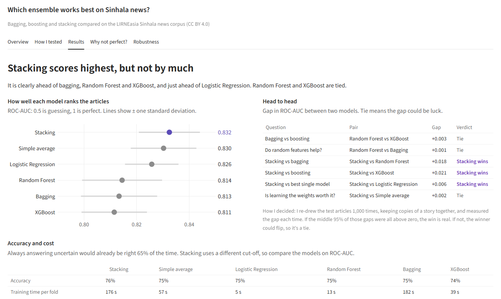
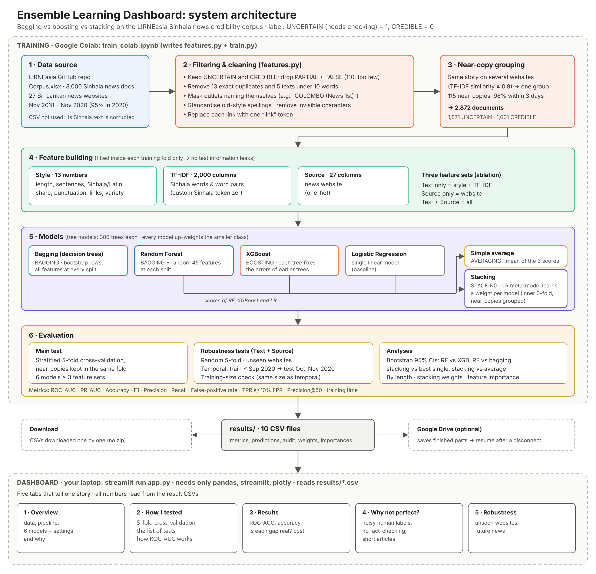

# Bagging, boosting and stacking on Sinhala news

Which ensemble method works best for flagging Sinhala news articles that need fact-checking? I compare plain bagging, Random Forest, XGBoost and stacking (plus logistic regression and a simple average as baselines) on the [LIRNEasia Sinhala misinformation corpus](https://github.com/LIRNEasia/MisinformationCorpusSinhala), and show the results in a Streamlit dashboard.



## Results

ROC-AUC on 5-fold cross-validation, using text and source (the news website) as inputs:

| Model | ROC-AUC | Accuracy | Training time per fold |
|---|---|---|---|
| Stacking | 0.832 | 76% | 176 s |
| Simple average | 0.830 | 75% | 57 s |
| Logistic Regression | 0.826 | 75% | 5 s |
| Random Forest | 0.814 | 75% | 13 s |
| Bagging | 0.813 | 75% | 182 s |
| XGBoost | 0.811 | 74% | 39 s |

- Stacking is clearly ahead of bagging, Random Forest and XGBoost (by about 0.02), and just ahead of logistic regression (0.006). Its lead over the simple average could be luck.
- Random Forest and XGBoost are tied: the gap (0.003) is smaller than the change from fold to fold (about 0.014).
- The source alone scores 0.705 for every model. Adding it to the text helps a little (+0.009 for stacking).
- Scores drop on harder tests: 0.76 to 0.79 on websites not seen in training, and 0.67 to 0.70 when trained on articles up to September 2020 and tested on October–November 2020.

On this data, the choice of ensemble matters less than the features, the labels and where the test articles come from.

## Data

3,000 Sinhala news articles from 27 Sri Lankan websites (Nov 2018 – Nov 2020), labelled by LIRNEasia. The task is binary: UNCERTAIN = 1 (needs checking), CREDIBLE = 0. I dropped PARTIAL (83) and FALSE (27) because there are too few of them, and removed 13 duplicates and 5 texts under 10 words, leaving 2,872 articles (65% uncertain).

Cleaning also masks outlets that name themselves in the text, standardises an old Sinhala spelling style, removes invisible characters and replaces links with one token. The corpus is downloaded by the notebook; it is not stored in this repository.

## Method

| Model | Type | Settings |
|---|---|---|
| Bagging | Bagging | 300 full-depth trees, all features at every split |
| Random Forest | Bagging | 300 trees, √features (about 45) per split |
| XGBoost | Boosting | 300 trees, depth 6, learning rate 0.1, 80% of rows and columns per tree |
| Stacking | Stacking | RF, XGBoost and LR combined by a logistic regression, 3 inner folds |
| Simple average | Baseline for stacking | Mean of the RF, XGBoost and LR scores |
| Logistic Regression | Baseline | scikit-learn defaults |

- Inputs: 13 writing-style numbers and TF-IDF on Sinhala words and word pairs (text), and the news website (source). I compare text only, source only and both.
- All models up-weight the smaller class. Default settings, no tuning. Seed 42.
- Stratified 5-fold cross-validation. Copies of the same story on different websites stay in the same fold, and all features are fitted on the training folds only.
- Bootstrap 95% confidence intervals (1,000 resamples of story groups) decide whether a gap between two models is real.
- Robustness checks: random 5-fold, unseen websites, later news, and a random split of the same size.



## Repository

| Path | What it is |
|---|---|
| `train_colab.ipynb` | Training notebook, with the outputs of my Colab run. It writes `features.py` and `train.py` and runs them. |
| `results/` | The CSVs from that run, which the dashboard reads |
| `extra_checks.py` | More bootstrap comparisons from the saved predictions; writes `results/extra_comparisons.csv` |
| `app.py`, `.streamlit/` | The Streamlit dashboard and its theme |
| `architecture.png` | System diagram |

## Running it

The results are already in `results/`, so the dashboard runs without training:

```bash
pip install -r requirements.txt
python -m streamlit run app.py
```

It opens at http://localhost:8501.

To train again, open `train_colab.ipynb` in Google Colab and choose Runtime > Run all. My run used a T4 GPU runtime, but the models run on the CPU. The last cell downloads 10 CSVs: put them in `results/`, then run `python extra_checks.py`.

## Licence

Code: [MIT](LICENSE). Data: the LIRNEasia Sinhala misinformation corpus (Jayawickrama et al., 2021) is licensed under CC BY 4.0; the files in `results/` are derived from it.
